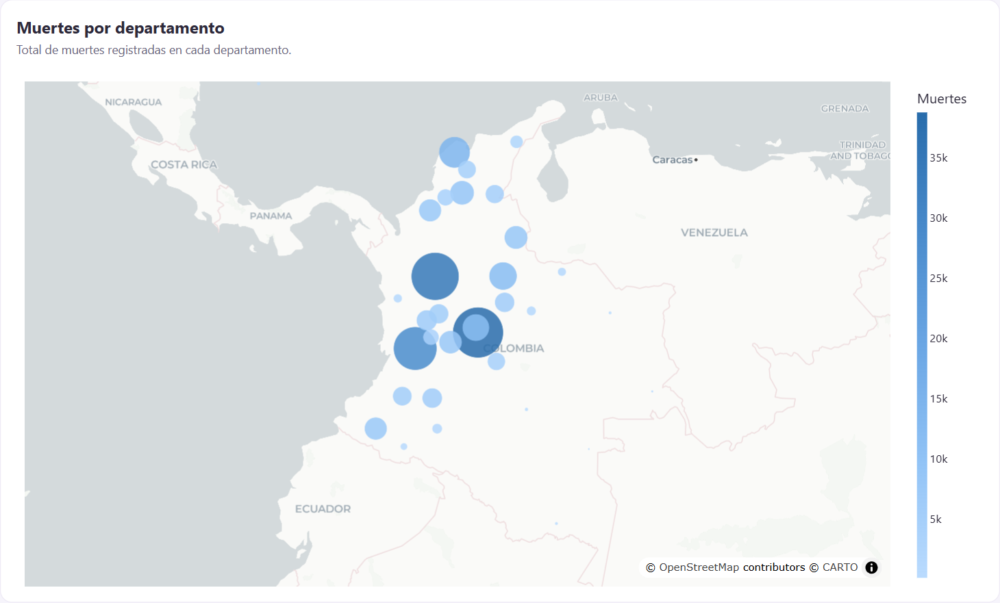
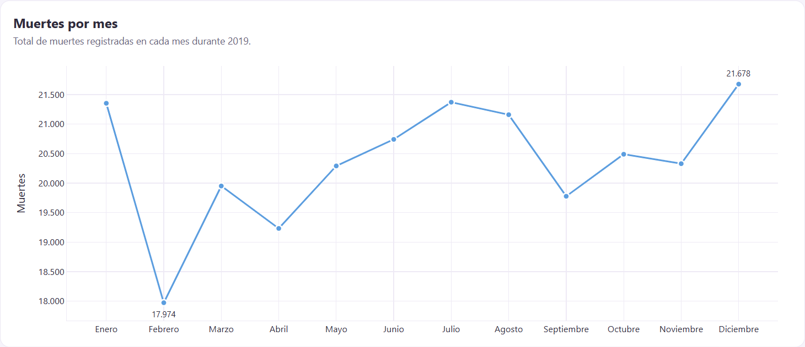
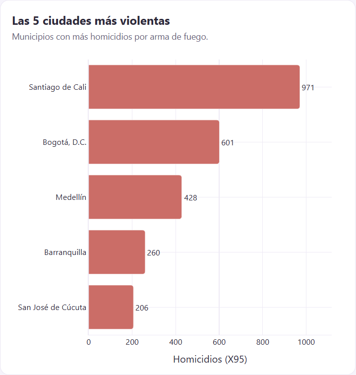
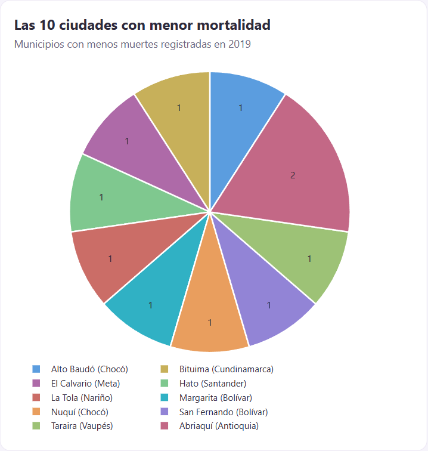
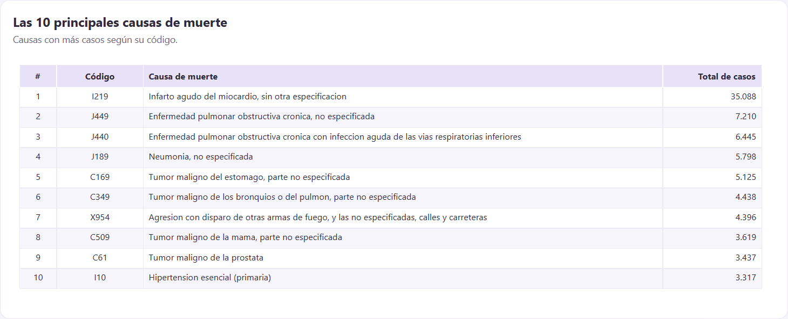
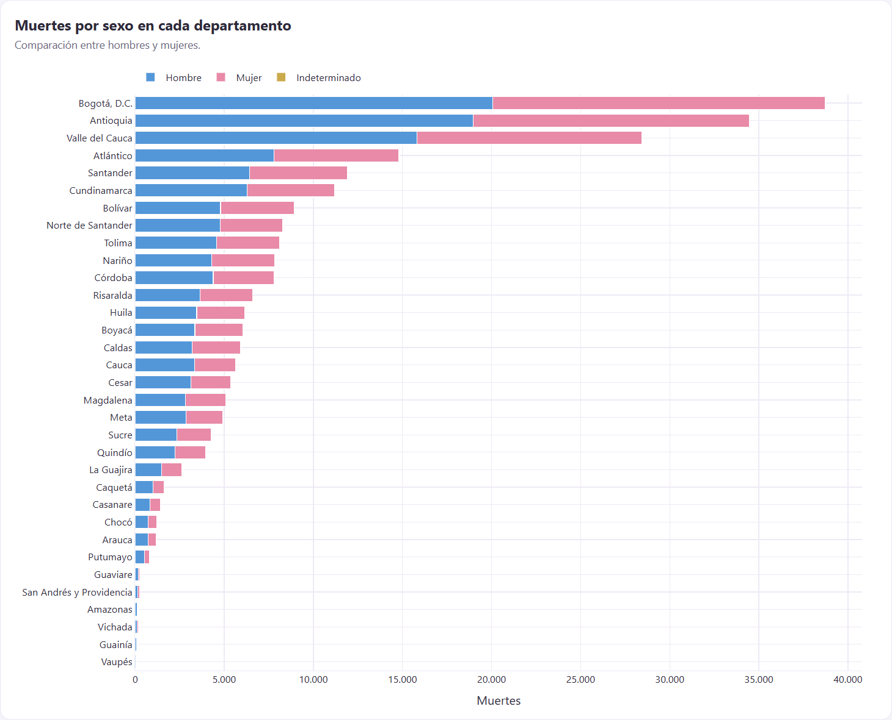
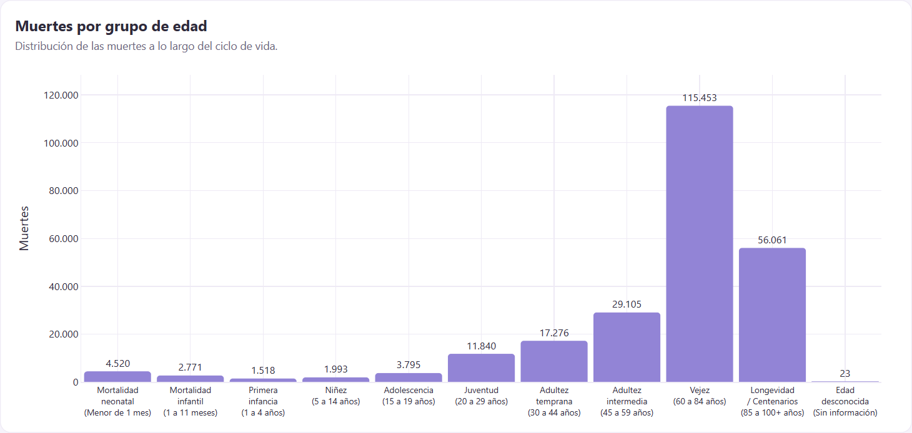

# Mortalidad en Colombia 2019

Aplicación web interactiva hecha con **Python, Plotly y Dash** para analizar las muertes no fetales registradas en Colombia durante el año 2019.

- **Aplicación en línea (Render):** https://mortalidad-en-colombia-88us.onrender.com
- **Repositorio (GitHub):** https://github.com/andreyruiz08/Mortalidad-en-Colombia

Autor: **Andrey Ruiz**

---

## Introducción

En 2019, Colombia registró un número significativo de muertes no fetales. Para un mejor entendimiento de este fenómeno, a través del dataset Estadísticas Vitales del DANE 2019, este aplicativo sintetiza la información en siete visualizaciones interactivas. Con ellas se puede ver dónde, cuándo, de qué y a qué edad muere la población.

## Objetivo

Identificar patrones demográficos y regionales de la mortalidad en Colombia durante 2019:

- Cómo se distribuyen las muertes entre departamentos y a lo largo del año;
- Qué ciudades concentran mayor número de homicidios por arma de fuego y cuáles registran menos muertes;
- Cuáles son las principales causas de muerte;
- Qué diferencias hay entre hombres y mujeres y entre las etapas del ciclo de vida.

## Estructura del proyecto

```
Mortalidad-en-Colombia/
├── app.py               # Aplicación Dash: crea las 7 figuras y el diseño de la página
├── datos.py             # Lectura de los Excel y cálculo de las tablas de cada gráfico
├── requirements.txt     # Librerías y versiones necesarias
├── .python-version      # Versión de Python usada en Render (3.11.11)
├── assets/
│   └── style.css        # Estilos de la página
├── data/
│   ├── Datosmortalidad.xlsx                 # Defunciones no fetales 2019 (DANE)
│   ├── Codigoscausamuerte.xlsx              # Catálogo de causas CIE-10
│   ├── divisionpoliticoadministrativa.xlsx  # DIVIPOLA: departamentos, municipios y coordenadas
│   └── mortalidad_2019.csv                  # Copia liviana de Datosmortalidad.xlsx para agilizar despliegue
└── capturas/            # Imágenes usadas en este README
```

## Requisitos

- Python 3.11 o superior

| Librería | Versión | Propósito |
|---|---|---|
| dash | 4.4.1 | Aplicación web y componentes de la página |
| plotly | 7.1.0 | Gráficos interactivos |
| pandas | 3.1.0 | Lectura y procesamiento de los datos |
| python-calamine | 0.9.0 | Lectura rápida de archivos Excel |
| gunicorn | 26.2.0 | Servidor web en Render |

## Despliegue en Render

1. Se subió el proyecto a un repositorio público de GitHub.
2. En Render se creó un **Web Service** conectado a ese repositorio, con la rama `main`.
3. Configuración del servicio:
   - **Runtime:** Python 3
   - **Build Command:** `pip install -r requirements.txt`
   - **Start Command:** `gunicorn app:server`
   - **Plan:** Free
   - **Variable de entorno:** `PYTHON_VERSION = 3.11.11`
4. Render automáticamente instala las librerías, inicia la aplicación y la publica en una URL pública.

La línea `server = app.server` de `app.py` le da a gunicorn acceso al servidor Flask interno de Dash.

## Software

- **Python 3.11**
- **Dash** 
- **Plotly** 
- **pandas** 
- **Git y GitHub** 
- **Render** 

## Instalación

```bash
# 1. Clonar el repositorio
git clone https://github.com/andreyruiz08/Mortalidad-en-Colombia.git
cd Mortalidad-en-Colombia

# 2. Crear y activar un entorno virtual
python -m venv .venv
.venv\Scripts\activate          # Windows
# source .venv/bin/activate     # macOS / Linux

# 3. Instalar las librerías
pip install -r requirements.txt

# 4. Ejecutar la aplicación
python app.py
```

Luego abre http://127.0.0.1:8050 en tu navegador.

## Visualizaciones y resultados

### 1. Mapa: Muertes por departamento



Cada círculo se ubica en el centro geográfico del departamento. El total de muertes se indica según el tamaño y color del círculo.

**Hallazgos principales:**
- **Bogotá D.C. (38.760), Antioquia (34.473) y Valle del Cauca (28.443)** concentran el **41,6 %** de todas las muertes del país.
- Los departamentos de la Amazonía y la Orinoquía registran menos de 200 muertes cada uno: Vaupés (87), Guainía (115), Vichada (188) y Amazonas (190).


### 2. Gráfico de líneas: Muertes por mes



**Hallazgos principales:**
- El promedio fue de **20.363 muertes por mes**.
- **Diciembre** fue el mes con mayor número de muertes (**21.678**) y **febrero** el de menor (**17.974**).
- Debido a que Febrero tiene solo 28 días, su número es bajo. Cuando observamos muertes por día, febrero (642), marzo (644) y abril (641) son los meses más bajos; diciembre (699), junio (691) y julio (689) son los más altos.

### 3. Gráfico de barras: Las 5 ciudades más violentas



Se cuentan los homicidios con código X95 en cada municipio.

**Hallazgos principales:**
- A pesar de que Bogotá tiene mayor población, **Santiago de Cali** encabeza la lista con **971** homicidios por arma de fuego.
- Detrás le siguen **Medellín (428)**, **Barranquilla (260)** y **San José de Cúcuta (206)**.
- Estas 5 ciudades suman 2.466 casos, el **26,6 %** de los 9.273 homicidios por arma de fuego del país.

### 4. Gráfico circular: Las 10 ciudades con menor mortalidad



Se tomaron los municipios con menos muertes registradas en 2019. Se excluyeron las áreas no municipalizadas porque no son ciudades.

**Hallazgos principales:**
- Nueve municipios registraron **una sola muerte**: Alto Baudó, Bituima, El Calvario, Hato, La Tola, Margarita, Nuquí, San Fernando y Taraira. El décimo es Abriaquí, con 2.
- Los anteriores son municipios pequeños o apartados de Chocó, Bolívar, Vaupés y Nariño. Las cifras tan bajas en estas zonas pueden deberse a poca población o a falta de información registrada.
- “Hay varios municipios empatados; dentro de cada empate se ordenan alfabéticamente.

### 5. Tabla: Las 10 principales causas de muerte



**Hallazgos principales:**
- El **infarto agudo del miocardio (I219)** es por diferencia la primera causa con un total de **35.088** muertes, el **14,4 %** del total del país.
- En la lista predominan las enfermedades crónicas: EPOC (J449, J440), neumonía (J189), cáncer de estómago, pulmón, mama y próstata, e hipertensión.
- La única causa violenta en el top 10 es **X954**, agresión con disparo de arma de fuego en calles y carreteras, con **4.396** casos.

### 6. Gráfico de barras apiladas: Muertes por sexo en cada departamento



**Hallazgos:**
- En total murieron **134.573 hombres (55,1 %)** y **109.689 mujeres (44,9 %)**. Además, hay 93 casos con sexo indeterminado.
- **En todos los departamentos mueren más hombres que mujeres.**
- La diferencia es mayor en departamentos de la Amazonía y la Orinoquía. En **Guaviare** mueren 3,4 hombres por cada mujer, en **Guainía** 2,1 y en **Amazonas** 1,9. Mientras que en **Bogotá D.C.** (1,07) y **Atlántico** (1,11) la diferencia es menor.

### 7. Histograma: Muertes por grupo de edad



La variable `GRUPO_EDAD1` se agrupó según la tabla de referencia del DANE.

**Hallazgos:**
- La mortalidad se concentra en la vejez: **60 a 84 años (115.453; 47,2 %)** y **85 años o más (56.061; 22,9 %)**. Juntos suman el **70,2 %** de las muertes.
- En la niñez se ve un pico en el **primer mes de vida (4.520 muertes neonatales)**, mayor que en todo el resto del primer año (2.771) y que entre 1 y 4 años (1.518).
- Las muertes aumentan con claridad entre la adolescencia (3.795) y la juventud (11.840).
- Solo 23 registros no tienen información de edad.

---

**Fuente de los datos:** DANE, Estadísticas Vitales 2019 (defunciones no fetales), catálogo CIE-10 y División Político-Administrativa de Colombia (DIVIPOLA).
